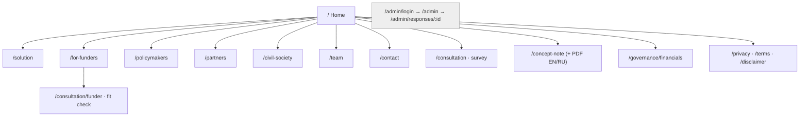
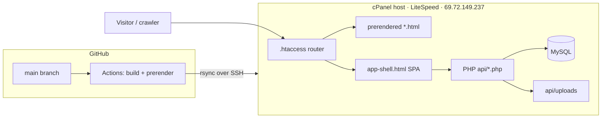

# EECA Lung Health Hub — Website and Project Audit

**Date:** 15 October 2026 · **Production URL:** https://eecalunghealth.com/ · **Repository:** https://github.com/InnerFlect-Tech/EECALungHealth (branch `main`, commit `c311fc8`)

**Method.** Every statement below was taken from one of three sources: the live production site (fetched without JavaScript with `curl`, 15 October 2026, around 09:25 UTC), the repository at commit `c311fc8`, or the GitHub Actions deployment logs. Where a statement could not be checked against one of these, it is marked **UNVERIFIED**. Nothing was changed on the production system to produce this audit.

**Status labels used throughout**

| Label | Meaning |
|---|---|
| **LIVE** | Visible and working on the deployed site today |
| **IMPLEMENTED** | Present in code, but not visible to the public or not shown working |
| **PLANNED** | Described on the site or in documents, with no implementation in the repository |
| **UNVERIFIED** | Cannot be established from the available evidence |

---

## A. Executive factual overview

1. **What the site is.** A public information and fundraising website for the *EECA Lung Health Hub*, a proposed regional platform for tuberculosis (TB) and lung-health policy in nine countries of Eastern Europe and Central Asia. The site also runs a working stakeholder survey and a private admin area for reviewing survey responses.
2. **What the Hub is.** A *proposal*. The site and concept note describe a two-year, four-phase programme with a total value of **$1.2 million**, opening with a **$100,000, six-month Foundation Phase in one country**. The product it describes (an AI-assisted legislative platform called the *Engine*, a coordination layer called the *Bridge*, and an early-warning layer called the *Shield*) does **not exist in this repository**. The product images on the site are labelled "Illustrative product mockup" and "AI-generated".
3. **What is actually built and live.** A 15-page bilingual (English and Russian) marketing site; a concept note served as a web page and as PDF in two languages; a 16-step branching stakeholder survey with file upload, stored in MySQL; a 5-question funder fit check; and a password-protected admin area with response review, notes, analytics and CSV export.
4. **Deployment.** The live site matches the latest commit exactly. It was deployed automatically on 15 October 2026 at 09:02 UTC, and the post-deploy smoke test passed on all 16 checked URLs.
5. **Accessibility for automated readers.** Until 15 October 2026 the site was a client-side-only React application. Any tool that does not run JavaScript, such as ChatGPT's page fetcher, received an empty page. This was fixed in the deployment of 15 October 2026 (prerendering). Three problems remain that still mislead automated readers (section B.3). The most serious is that **every page declares the homepage as its canonical URL**.

---

## B. Deployment and accessibility diagnosis

### B.1 Framework, hosting and deployment (confirmed)

| Item | Value | Source |
|---|---|---|
| Front end | React 19 + Vite + TypeScript, `react-router-dom` 7, client-side routing | `web/package.json`, `web/src/App.tsx` |
| Back end | PHP endpoints + MySQL (`consultation_responses`, `admin_users` tables) | `web/public/api/*.php`, `web/public/api/schema.sql` |
| Unused code | `web/supabase/` (migration + edge function), not wired to anything; `@supabase/supabase-js` is still a dependency | `HANDOFF.md`, `web/package.json` |
| Legacy code | Root-level `index.html`, `consultation.html`, `team.html` and similar files: a frozen static site that is not deployed | `HANDOFF.md` |
| Hosting | Shared hosting (cPanel), web server **LiteSpeed**, IP `69.72.149.237`, nameservers `ns1–ns4.mysecurecloudhost.com` | response headers, DNS lookup |
| Routing on server | `web/public/.htaccess`: real files are served as-is; `/team` is mapped to `/team.html` (prerendered); everything else gets `app-shell.html` | `web/public/.htaccess` |
| Deployment | GitHub Actions `.github/workflows/deploy.yml`. It runs on every push to `main` that touches `web/**`, or by hand. Steps: `npm ci && npm run build` (includes prerendering), then `rsync` over SSH (no `--delete`; `api/config.php` and `api/uploads/` are protected), then a smoke test | `.github/workflows/deploy.yml` |
| Current production version | Commit `c311fc8`, "fix: prerender public pages so ChatGPT and crawlers can read the site", deployed in run `38710042174` on 2026-10-15 at 09:02 UTC, result success, 1 min 5 s | `gh run list --workflow deploy.yml` |
| Earlier deployments | 2026-09-24, 09-21, 09-10, 09-08 (manual runs, all successful) | same |
| Repository history | 100 commits, first on 2026-06-05 | `git log` |

### B.2 Live checks (15 Oct 2026, ~09:25 UTC)

| Test | Result |
|---|---|
| `https://eecalunghealth.com/` | 200, `text/html`, 28,289 bytes, `last-modified: Thu, 15 Oct 2026 09:03:13 GMT` |
| `https://www.eecalunghealth.com/` | 200, served directly, **not redirected** to the bare domain; canonical tag points to the bare domain |
| `http://eecalunghealth.com/` | 301 redirect to `https://eecalunghealth.com/` |
| `http://www.eecalunghealth.com/` | 301 redirect to `https://www.eecalunghealth.com/` |
| Cache-busting test (`/?cb=1`) | Byte-for-byte identical to `/`. Both are identical to a local build of `c311fc8` (same asset hash `index-6ySk1A-b.js`). **No stale cache.** |
| User agents `GPTBot`, `ChatGPT-User`, `OAI-SearchBot` | All 200, same content. No bot blocking was observed from this server. |
| `robots.txt` | `Allow: /`, `Disallow: /admin`, `Disallow: /design`, plus a sitemap line |
| `sitemap.xml` | 200, `application/xml`, 15 URLs |
| Unknown URL (`/nonexistent-xyz`) | **200** with the empty app shell. There is no real 404 page (a "soft 404"). |
| `sovereigntyhub.innovations4health.org` (old domain) | Does not resolve in DNS. The old domain is retired. |
| `app.eecalunghealth.com` (appears in the mockup images) | Does not resolve. No such application is deployed. |
| `sejm.eecalunghealth.com` | 200, title "Sejm Lung Health MP Scanner". This is a separate repository and is not audited here. |
| Security headers | **None set**: no `Strict-Transport-Security`, `Content-Security-Policy`, `X-Frame-Options`, `X-Content-Type-Options` or `Referrer-Policy`. No `Cache-Control` either. |
| Other response headers | `server: LiteSpeed`, `vary: User-Agent`, HTTP/2 and HTTP/3 offered |
| `/api/session.php` | 200 `{"authenticated":false}` |
| `/api/responses.php`, `/api/download.php` | 401 (correctly protected) |
| `/api/submit.php` (GET) | 405 (only accepts form submissions) |
| `/api/schema.sql` | 403 (blocked) |
| `/api/config.php` | 200 with an empty body (PHP runs the file, so no secrets are shown) |
| Internal draft files (`concept-note-revision.pdf`, `concept-note-body-revision.html`) | Not published. They fall back to the app shell. They are excluded from the build by `web/vite.config.ts`. |

### B.3 Accessibility diagnosis — confirmed problems

1. **CONFIRMED, fixed on 15 Oct 2026: the site used to be empty without JavaScript.** Before commit `c311fc8`, every URL returned the React shell: an HTML file with no text, whose content only appears after JavaScript runs. The shell still exists as `app-shell.html`, and its visible text is empty (3 characters). Tools that do not run JavaScript, including ChatGPT's page fetcher, saw nothing. Since the deployment of 15 Oct 2026 at 09:02 UTC, the 15 public routes are served as prerendered HTML containing the full text. Another ChatGPT environment that failed earlier was most likely fetching before this deployment, or reading a copy it had cached then (this last part is a **hypothesis**; it cannot be checked from here).
2. **CONFIRMED, still live: every page names the homepage as its canonical URL.** `/team`, `/for-funders`, `/concept-note` and every other prerendered page contain `<link rel="canonical" href="https://eecalunghealth.com/">`. Search engines and AI indexers that respect canonical tags will treat each sub-page as a duplicate of the homepage and may drop it from their index. The Open Graph tags (`og:url`, `og:title`) are also the homepage's on every page. Cause: these tags are fixed in `web/index.html` and the prerender step does not rewrite them.
3. **CONFIRMED, still live: some statistics read "0" without JavaScript.** On `/policymakers`, `/partners` and `/civil-society`, the prerendered HTML says "0K TB cases a year", "0 national caucuses" and "0 network active in EECA since". The animated counters were captured at their starting value. A reader that does not run JavaScript gets wrong figures (the real values are 225K, 9 and 2016).
4. **CONFIRMED: the page title is generic on some pages.** `/team` carries the homepage title ("EECA Lung Health Hub – from decision to delivered care") because that page does not set its own title.
5. **CONFIRMED: soft 404s.** Any unknown URL returns 200 with an empty shell instead of a 404 status.
6. **CONFIRMED: `www` is not redirected to the bare domain.** The canonical tag points to the bare domain, which limits the harm.
7. **CONFIRMED: no security headers** (see B.2).

**Hypotheses, not confirmed:**

- `vary: User-Agent` suggests LiteSpeed may cache per user agent. No difference was observed for the three OpenAI user agents tested.
- Firewall rules at the hosting provider (for example blocking by IP range or rate limit) could block some cloud fetchers. This could not be tested from this machine and it does not affect user-agent checks.

**Recommended fixes (not applied; each needs approval):**

- Write a per-page canonical URL, `og:url` and `og:title` during prerendering.
- Render final counter values into the prerendered HTML.
- Set a page title on `/team`.
- Return a real 404 status for unknown routes.
- Redirect `www` to the bare domain with a 301.
- Add HSTS, `X-Content-Type-Options`, `Referrer-Policy` and `X-Frame-Options` headers in `.htaccess`.

---

## C. Complete sitemap



| Route | Status | Indexed | Linked from main menu |
|---|---|---|---|
| `/` | LIVE | sitemap, priority 1.0 | logo |
| `/solution` | LIVE | yes (0.9) | yes |
| `/for-funders` | LIVE | yes (0.9) | yes, under "Contributors" |
| `/policymakers` | LIVE | yes (0.9) | yes, under "Contributors" |
| `/partners` | LIVE | yes (0.9) | yes, under "Contributors" |
| `/civil-society` | LIVE | yes (0.9) | yes, under "Contributors" |
| `/concept-note` | LIVE | yes (0.8) | footer and buttons |
| `/consultation` | LIVE (working form) | yes (0.8) | "Take the Survey" button |
| `/consultation/funder` | LIVE (working form) | yes (0.6) | from `/for-funders` |
| `/governance/financials` | LIVE (short page) | yes (0.7) | footer |
| `/team` | LIVE | yes (0.7) | yes |
| `/contact` | LIVE (no contact details; points to the survey) | yes (0.6) | yes |
| `/privacy`, `/terms`, `/disclaimer` | LIVE | yes (0.3) | footer |
| `/donors` | redirects to `/partners` | no | no |
| `/design` | LIVE but hidden (internal design reference, `noindex`, blocked in robots.txt) | no | no |
| `/admin/login`, `/admin`, `/admin/responses/:id` | LIVE, password-protected | no (`Disallow: /admin`) | no |
| `/partners/foundations`, `/partners/tech`, `/partners/targets` | IMPLEMENTED only in development builds; **not in production**. The code comment says they "still carry claims that are not true yet (live pilots, committed co-funding)". | no | no |
| `/concept-note.pdf`, `/concept-note-ru.pdf` | LIVE (668 KB, 770 KB) | — | from `/concept-note` |
| `/audit/2026-10-15` | this audit (added in this change) | sitemap | no (link only) |

**Main navigation:** Solution · Contributors (Funders, Policymakers, Partners, Civil Society) · Team · Contact · *Take the Survey* · EN/RU language switch.
**Footer:** Explore (all public pages) · Legal (Privacy, Terms, Disclaimer) · "Financials & filings" · "With support from Innerflect".

---

## D. Page-by-page content inventory

Every public page shares the same set of trust badges: "Aligned with WHO Europe · With support from the Global TB Caucus · active in EECA since 2016 · GDPR-equivalent data protection · Sovereign, in-region hosting · Independent audit · Q3 2027 roadmap". They also share the same footer disclaimer: "informational only … not an offer … Figures and plans are indicative".
**"Request a Consultation"** opens an email (`mailto:`) addressed to the Global TB Caucus Parliamentary Engagement Lead, copied to the Innerflect address, with a pre-filled template. It is not a booking system.

### D.1 Home — `https://eecalunghealth.com/`
- **Title:** "EECA Lung Health Hub – from decision to delivered care"
- **H1:** "Decisions delivered as care." Lead: "A regional, AI-powered platform closing the lung-health delivery gap across nine EECA countries. Seeking Phase 1 partners to launch the Foundation Phase in one EECA country."
- **Figures:** 225K TB cases a year in the WHO European Region; "Weeks from policy to action"; 9 national caucuses; $100K Phase 1 ask; "3 of 6" of the region's highest-burden TB countries are partner countries; 6 months; 47% of TB-affected households face catastrophic costs; $3 trillion in losses and 5.7 million additional deaths if the 2030 target slips to 2045; $78–3,800 household cost per TB episode. Sources cited: WHO Global TB Report 2025; Silva et al., *Lancet Global Health* 2021.
- **Sections:** at a glance · Phase 1 ask · team (3 leads) · three audiences · survey call · "What is the Hub" (Engine, Bridge, Shield; 9 country names) · cost of delay · four outcomes (certainty, protection, sovereignty, confidence) · approach · four phases · governance (5 bodies) · final call to action.
- **Calls to action:** Help Make This Possible (to `/for-funders`) · Request a Consultation (email) · Take the Survey · Read the Concept Note · Get to Know the Team · Get an Idea of the Solution.
- **Audience:** funders first, then policymakers, partners and civil society. **Complete.**

### D.2 Solution — `/solution`
- **H1:** "The Solution". One platform for deciding, coordinating and delivering care.
- Four mockups of `app.eecalunghealth.com/{ukraine,budget,pipeline,overview}`, each labelled **"Illustrative product mockup"**. Two "in use" images are labelled **"AI-generated"**.
- **Engine:** a secure workspace for members of parliament, AI drafting with sign-off by a person, comparison with neighbouring countries. "What used to take months can now take days."
- **Bridge:** flags countries that are ready, organises meetings and summits, prepares briefs.
- **Shield:** round-the-clock early warning, a live view of where care may be interrupted, alerts and dashboards.
- **Claims:** ISO 27001-grade security, GDPR-equivalent protection, sovereign hosting, human review, independent audit. **Complete as a description. The product it describes is PLANNED.**

### D.3 For Funders — `/for-funders`
- **H1:** "A Foundation Phase partnership – a working national pilot in one EECA country." "…delivers a live, working solution in six months – before any further funding is asked."
- **Budget split** (indicative): Engine 40% · Bridge 25% · Shield 20% · Governance, evaluation and audit 15%.
- **Roadmap:** months 1–6 Foundation (one country) · 7–12 Replication · 13–18 Regional platform · 19–24 Scale and integration (nine countries).
- **Call to action text:** "We share the phased budget, the governance package and **the working alpha** in one call." (The "working alpha" is **UNVERIFIED**; see I.)
- Links to the 2-minute fit check. **Complete.**

### D.4 Funder fit check — `/consultation/funder`
- **H1:** "A five-question fit check." Fields: organisation; organisation type (6 options); indicative budget (up to $100K / $100K–250K / $250K–1M / $1M+ / undecided); decision timeline (next 60 days / Q4 2026 / 2027 cycle / longer); desired outcome (optional).
- Submits through the same PHP endpoint as the survey. **LIVE.**

### D.5 Policymakers — `/policymakers`
- **H1:** "Act with certainty. See it delivered." Moves from commitment to enacted policy "in weeks".
- **Steps:** Draft · Coordinate · Enact · Deliver. Value: certainty, sovereignty, low risk.
- **What you get:** an invitation-only portal for members of parliament, AI-assisted drafting, decision briefs, a peer network of nine caucuses and former members. **The portal is PLANNED.**
- Counters show "0" without JavaScript (B.3 item 3).

### D.6 Partners — `/partners`
- **H1:** "A governed platform to build on." What partners bring: technology, diagnostics, capital. What they gain: market access, environmental and social-impact (ESG/SDG) reporting, association with the parliamentary network.
- **Partner tiers:**
  - **Founding Funder** (months 1–6): named seat, co-branded launch, month-6 report, audit access.
  - **Regional Partner** (months 7–12): a 3–4 country replication cluster, board-observer seat.
  - **Platform Underwriter** (months 13–24): anchors Phase 2, "full Sovereignty App", co-design seat, "direct link to WHO Europe TB-Free Central Asia programme".
- **Inconsistency:** this page gives Phase 3 as months 13–24. `/for-funders` and the concept note give Phase 2 as months 13–18 and Phase 3 as months 19–24.

### D.7 Civil Society — `/civil-society`
- **H1:** "Your evidence, reaching the people who can act on it."
- **Steps:** Share · Reach · Commit · Fund. Offers a standing seat on the Civil Society Council and tracking from submission to outcome. **The mechanism is PLANNED.** The only live channel is the survey.

### D.8 Concept Note — `/concept-note`
- "Detailed Investment Proposal", last updated September 2026, available in English and Russian, with PDF downloads.
- **Content:** summarised in sections F–G below. Programme total **$1.2M** over two years, Phase 1 **$100K** for six months. References: ECDC/WHO 2025, Human Rights Watch (22 Jan 2026), Global TB Caucus, WHO Global strategy on digital health.

### D.9 Governance & Financials — `/governance/financials`
- **H1:** "Financials & filings".
- Independent audit scheduled for **Q3 2027**; interim reporting every 90 days; governance by 5 bodies; transparency principles.
- **No financial statements, filings or named fiscal host are published.** The code comment reads "Fully filled in W6; stub content". **Incomplete.**

### D.10 Team — `/team`
- **H1:** "Core Team".
  - Alesia Matusevych, Parliamentary Engagement Lead.
  - Gayané Arustamyan, Civil Society & Strategic Partnerships Lead (15+ years; Global Fund, UN agencies).
  - Daniel Fernandes, AI & Systems Architecture Lead.
- Links to LinkedIn profiles. No support staff are listed. **Complete.**

### D.11 Consultation survey — `/consultation`
- **H1:** "Your input will shape what gets built first." Takes 7–10 minutes, 16 steps, branching by perspective:
  - community or civil society
  - member of parliament or policy-maker
  - institutional partner or donor
  - other
- **Shared questions:** country and role; urgency; top three risks; ranking of Hub functions; impact of migration; possible contributions; follow-up consent. Each branch adds its own questions, and the community branch has an optional document upload.
- **Privacy notice:** no individual patient data is collected. Results are scored for urgency and partner readiness (`web/src/lib/scoring.ts`). **LIVE.**

### D.12 Contact — `/contact`
- **H1:** "Let's talk." Sends people to the survey form. **No email, phone or address is given on the page.** The only direct address is the consultation `mailto:` link used elsewhere.

### D.13 Legal pages — `/privacy`, `/terms`, `/disclaimer`
- All last updated 14 July 2026.
- **Privacy:** collects survey answers and attachments, server logs and one session cookie used only for admin. Legal basis: consent and legitimate interest.
- **Disclaimer:** "not an offer or solicitation", figures are indicative, not medical advice. **Complete.** No legal entity or data controller is named (UNVERIFIED who the controller is).

---

## E. Product features and user journeys

| Feature | Status | Evidence |
|---|---|---|
| Bilingual site, EN/RU switch | LIVE | `web/src/i18n/` |
| Concept note as a web page and PDF, EN/RU | LIVE | `/concept-note`, `/concept-note.pdf`, `/concept-note-ru.pdf` |
| 16-step branching survey with validation and upload | LIVE | `web/src/lib/formSchema.ts`, `web/public/api/submit.php` |
| Urgency and partner-readiness scoring | IMPLEMENTED (used in admin) | `web/src/lib/scoring.ts` |
| Funder fit check | LIVE | `web/src/pages/FunderFitPage.tsx` |
| Admin login, response list, detail view, notes, analytics, CSV export, file download | LIVE (protected) | `web/src/pages/admin/*`, `web/public/api/responses.php`, `download.php` |
| "Request a Consultation" | LIVE as a pre-filled email only | `mailto:` link |
| Prerendered HTML and sitemap | LIVE since 2026-10-15 | `web/scripts/prerender.mjs` |
| "Activity feed" (alpha launch 2026-09-15, WHO alignment 2026-08-20, network review 2026-07-30) | IMPLEMENTED data, **not shown on any page** | `web/src/lib/activityFeed.ts` (not imported anywhere) |
| Engine / Bridge / Shield application (`app.eecalunghealth.com`) | **PLANNED.** Not in this repository; the domain does not resolve. | DNS check, repository search |

**Main user journeys (LIVE):**
1. **Funder:** Home, then Help Make This Possible, then `/for-funders`, then the fit check or a consultation email or the concept note.
2. **Stakeholder:** any page, then Take the Survey, then the 16-step survey, then the response is stored and reviewed in admin.
3. **Audience reader:** Contributors menu, then the policymakers, partners or civil-society page, then the survey or a consultation email.
4. **Admin:** `/admin/login`, then the dashboard (list, analytics, CSV), then a response's detail page and notes.

---

## F. Stakeholders, organisations and countries

- **Countries (9):** Armenia, Azerbaijan, Georgia, Kazakhstan, Kyrgyzstan, Moldova, Tajikistan, Ukraine, Uzbekistan. Highest burden named: Ukraine (42,000 estimated TB cases in 2023), Uzbekistan (20,000), Kazakhstan (14,000). Source: ECDC/WHO 2025, as cited in the concept note.
- **Global TB Caucus:** described as providing "support". Its regional network has been "active since 2016" with nine national caucuses. In September 2026 the site deliberately reframed the relationship from "collaborator" to "supporter" (commits of 2026-09-10 and 2026-09-21). **The formal agreement is UNVERIFIED.**
- **WHO Europe:** shown as an "Aligned with WHO Europe" badge and a "direct link to WHO Europe TB-Free Central Asia programme". **No public WHO document confirming this was found. UNVERIFIED.**
- **Innerflect:** credited in the footer ("With support from Innerflect"); builds and runs the site.
- **Intended users:** members of parliament and parliamentary staff; ministries of health and finance; civil society and patient organisations; key and vulnerable populations; funders (national, corporate and family foundations, multilateral and bilateral donors); technology, diagnostics and supply-chain partners.
- **Named people:** the three leads listed in D.10.

---

## G. Programme, funding and governance

**Phases** (concept note §4 and `/for-funders`):

| Phase | Months | Scope | Deliverables |
|---|---|---|---|
| 1 · Foundation | 1–6 | One country, chosen from the 9 caucuses by readiness, momentum and donor fit | Lean governance; a "Legislative Ask Map"; the core Hub App on sovereign infrastructure (roles and login, country profile, stakeholder directory, caucus workspace); a screening-intelligence dashboard with a national-reporting interoperability pilot; a caucus legislative workplan |
| 1R · Replication | 7–12 | Further countries, in parallel | Per-country Ask Map, dashboard and workplan |
| 2 · Regional platform | 13–18 | Multiple countries | Full "Sovereignty App": portal for members of parliament, comparative-law database, AI drafting with human review, EN/RU, hardened security, first regional summit |
| 3 · Scale & integration | 19–24 | All 9 countries | Full Bridge and full Shield, evaluation, domestic-financing strategy, institutionalisation |

**Money**
- Total programme value: **$1.2M**. Phase 1 ask: **$100K**.
- Pillar split: 40 / 25 / 20 / 15 (Engine / Bridge / Shield / Governance).
- The line-item budget is "available on request" and is not public.
- Partner tiers in the fit check: up to $100K, $100K–250K, $250K–1M, $1M+.
- **No funder, signed grant or committed co-funding is stated anywhere on the live site.** The unpublished partner draft pages are noted in code as carrying "committed co-funding" claims that "are not true yet".

**Governance (proposed):** a Regional Steering Committee; a Parliamentary Council (the 9 caucuses); a Civil Society Council; an Advisory Board of former members of parliament; and a Technical Secretariat (3 leads plus support roles for finance, administration, communications and an AI assistant). Independent audit in Q3 2027 and reporting every 90 days. **Every body is PLANNED; none is shown as constituted.** No fiscal host or legal entity is named (**UNVERIFIED**).

---

## H. Current technical architecture



- **Build:** `tsc -b && vite build && node scripts/prerender.mjs`. The prerender step uses headless Chrome (Puppeteer). The build fails if a route in `App.tsx` is not listed as either public or excluded.
- **Data:** MySQL tables `consultation_responses` and `admin_users`. Uploads go to `api/uploads/` on the server, which is not reachable from the web (404).
- **Server-only configuration:** `api/config.php` is not in git and is protected from overwrite by rsync.
- **Quality status at `c311fc8`:** the build passes. ESLint reports **11 errors** (including `react-hooks/immutability`).

---

## I. Existing versus planned functionality

| Claim on the site | Status | Note |
|---|---|---|
| Public site, EN/RU, concept note, survey, fit check, admin | **LIVE** | Verified |
| "A regional, AI-powered platform" (home) | **PLANNED** | No AI code in the repository |
| Engine: MP portal, AI drafting, comparative-law database | **PLANNED** | Mockups only |
| Bridge: country-matching, summits, briefs | **PLANNED** | — |
| Shield: early warning, continuity mapping, dashboards | **PLANNED** | — |
| "The working alpha" (`/for-funders` call to action) and "Engine and Bridge modules running in a working alpha" (unused activity feed, 2026-09-15) | **UNVERIFIED** | Not in this repository; `app.eecalunghealth.com` does not resolve. It may refer to the separate Sejm Scanner (`sejm.eecalunghealth.com`), which is not established. |
| "Aligned with WHO Europe" and "WHO Europe alignment confirmed" | **UNVERIFIED** | No source document |
| ISO 27001-grade, GDPR-equivalent, sovereign in-region hosting | **UNVERIFIED / partly contradicted** | Hosting is shared cPanel (server location not verified); no certification shown; no security headers |
| Independent audit in Q3 2027 | **PLANNED** | — |
| "Commitment to enacted policy in weeks" / "within one week" | **UNVERIFIED** (aspirational) | No evidence presented |
| TB burden and household-cost figures | **Sourced** | WHO/ECDC 2025, *Lancet Global Health* 2021, HRW 2026 |
| Survey scoring and admin analytics | **LIVE / IMPLEMENTED** | — |

---

## J. Evidence, source references and uncertainties

**Code sources:**
- `web/src/App.tsx`
- `web/scripts/prerender.mjs`
- `web/public/.htaccess`
- `.github/workflows/deploy.yml`
- `web/DEPLOY.md`
- `HANDOFF.md` (state as of 2026-08-10; partly out of date, e.g. it says deployment is manual-only and the repository is private)
- `web/src/i18n/translations.ts`
- `web/src/lib/{formSchema,scoring,activityFeed,fundersData}.ts`
- `web/public/api/*`
- `docs/ssot-*.md`

**Live sources:** the URLs listed in B.2 and D. GitHub Actions run `38710042174`.

**Open uncertainties:**
1. The nature and status of the "working alpha".
2. The formal relationships with the Global TB Caucus and WHO Europe.
3. The legal entity, fiscal host and data controller.
4. Whether any funding is committed.
5. Which lead country has been chosen.
6. The physical location of hosting, which matters for the "sovereign" claim.
7. Survey response volume. Not inspected: the responses are private data.
8. The repository is **public** while `docs/` contains investment-proposal source documents. Whether that is intended is an open decision.

---

## K. Machine-readable summary

```json
{
  "audit_date": "2026-10-15",
  "production_url": "https://eecalunghealth.com/",
  "repo": "https://github.com/InnerFlect-Tech/EECALungHealth",
  "deployed_commit": "c311fc8",
  "deploy_run": {"id": 38710042174, "at": "2026-10-15T09:02:46Z", "result": "success"},
  "hosting": {"type": "cPanel shared", "server": "LiteSpeed", "ip": "69.72.149.237"},
  "stack": {"frontend": "React 19 + Vite + TypeScript, prerendered", "backend": "PHP + MySQL", "unused": "web/supabase"},
  "rendering": "prerendered static HTML for 15 public routes since 2026-10-15; client-side SPA before that",
  "accessibility_issues": [
    {"id": "spa-empty-html", "status": "fixed 2026-10-15", "confirmed": true},
    {"id": "canonical-points-to-home-on-all-pages", "status": "open", "confirmed": true},
    {"id": "counters-render-zero-without-js", "pages": ["/policymakers", "/partners", "/civil-society"], "status": "open", "confirmed": true},
    {"id": "soft-404", "status": "open", "confirmed": true},
    {"id": "www-not-redirected", "status": "open", "confirmed": true},
    {"id": "no-security-headers", "status": "open", "confirmed": true}
  ],
  "public_routes": ["/", "/solution", "/policymakers", "/partners", "/civil-society", "/for-funders", "/concept-note", "/governance/financials", "/team", "/consultation", "/consultation/funder", "/contact", "/privacy", "/terms", "/disclaimer"],
  "private_routes": ["/admin/login", "/admin", "/admin/responses/:id"],
  "countries": ["Armenia", "Azerbaijan", "Georgia", "Kazakhstan", "Kyrgyzstan", "Moldova", "Tajikistan", "Ukraine", "Uzbekistan"],
  "programme": {
    "total_usd": 1200000, "duration_months": 24,
    "phases": [
      {"id": "1", "name": "Foundation", "months": "1-6", "scope": "one country", "budget_usd": 100000},
      {"id": "1R", "name": "Replication", "months": "7-12"},
      {"id": "2", "name": "Regional platform", "months": "13-18"},
      {"id": "3", "name": "Scale & integration", "months": "19-24", "scope": "nine countries"}
    ],
    "allocation_pct": {"engine": 40, "bridge": 25, "shield": 20, "governance_evaluation_audit": 15},
    "committed_funding": "none stated"
  },
  "components": {
    "engine": "PLANNED", "bridge": "PLANNED", "shield": "PLANNED",
    "survey": "LIVE", "funder_fit_check": "LIVE", "admin": "LIVE", "concept_note_en_ru": "LIVE",
    "working_alpha": "UNVERIFIED"
  },
  "governance_bodies": ["Regional Steering Committee", "Parliamentary Council", "Civil Society Council", "Advisory Board of Ex-MPs", "Technical Secretariat"],
  "governance_status": "PLANNED",
  "unverified_claims": ["WHO Europe alignment", "working alpha", "ISO 27001-grade", "sovereign in-region hosting", "weeks from policy to action"]
}
```

---

## L. Six-week validation context

**What EECA currently is.** A fundraising-stage proposal with a professional bilingual website, a concept note, a working stakeholder survey and a funder fit check. It is backed by three named leads and presented with support from the Global TB Caucus regional network. **It is not yet an operating platform or institution.**

**Who it intends to serve.** Parliamentarians and their staff, and ministries of health and finance, in nine EECA countries (primary users). Civil society and affected communities (contributors and overseers). Funders and technology, diagnostics or capital partners (financiers and integrators). Patients are the intended *end* beneficiaries, but **no patient-facing service is proposed**.

**Problems it claims to solve.**
1. Slow translation of policy into implementation ("too many laws vs. too little implementation").
2. Health budgets that do not match disease burden.
3. Donor withdrawal from 2025–2026, pushing countries toward domestic financing.
4. Interrupted care caused by conflict, displacement and funding shocks.
5. Weak data governance limiting digital health.

**What has already been built.** Only the items marked LIVE in section E. In practice that is the website, the survey with its admin and scoring, the funder fit check and the concept note.

**What is still missing.**
- All three product components (Engine, Bridge, Shield).
- Any deployed application or demonstrable alpha.
- A chosen lead country.
- Constituted governance bodies.
- A named legal entity or fiscal host.
- Published financials.
- Evidence for the security and hosting claims.
- Proof of the WHO alignment.
- Any outcome data.

**Financial commitments.** No committed funding is shown. The ask is $100K for Phase 1 within a $1.2M programme. The line-item budget is private.

**Unvalidated assumptions.**
1. Parliamentarians will adopt a digital portal and AI drafting tools.
2. Faster legislation leads to better-financed care and better patient outcomes.
3. Nine caucuses can be mobilised through the Global TB Caucus network on the Hub's terms.
4. Funders will pay for parliamentary infrastructure instead of direct services.
5. $100K is enough for a "working solution, live in one country" in six months.
6. Usable national budget and supply data exist and can be shared.
7. "Sovereign hosting" is feasible within the budget.
8. Demand signals from the survey (response volume not examined here).

**Open strategic decisions.**
- Which country leads.
- Who the primary customer is (parliaments, ministries or donors).
- Whether to deliver patient-facing interventions, parliamentary services or a hybrid institutional execution model. This is the comparison the next team will run.
- The legal and fiscal home of the Hub.
- How it is financed after Phase 3.
- The formal relationships with the Global TB Caucus and WHO.
- Whether to keep AI as a headline claim before a product exists.
- Whether the repository and `docs/` should stay public.
